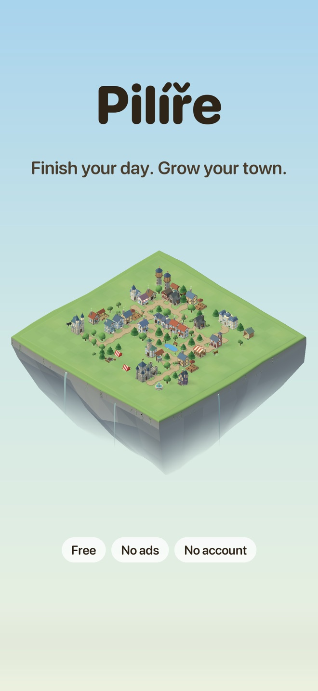
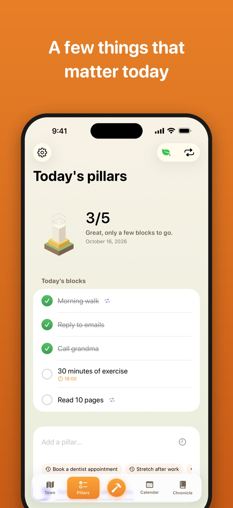
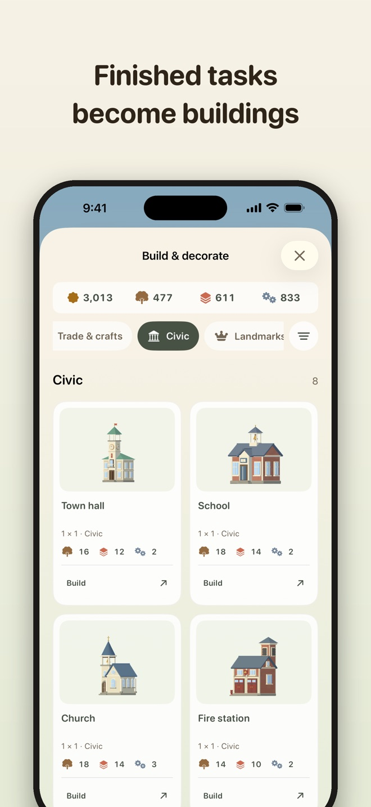
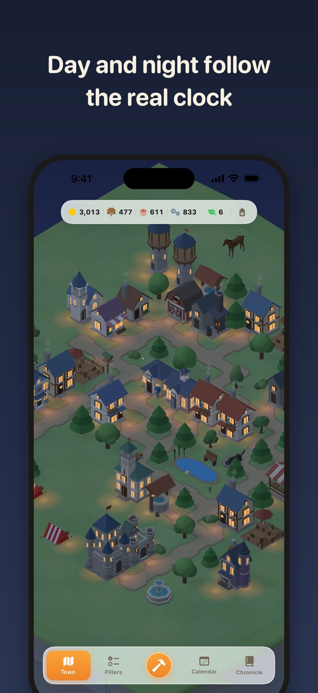
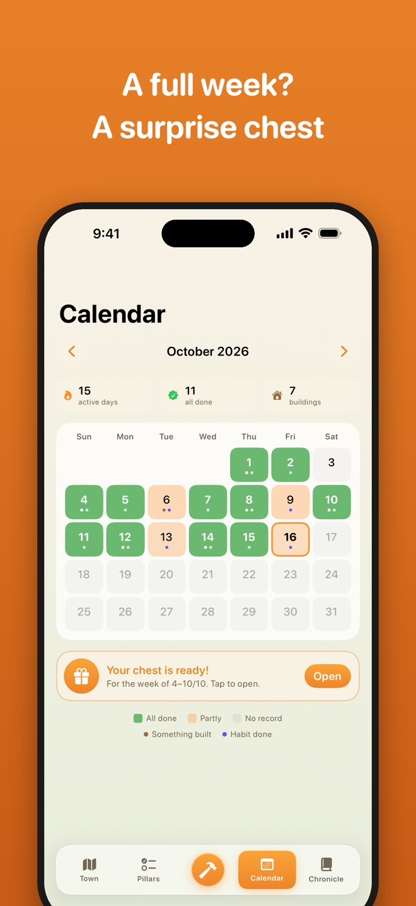

# Pilíře (Pillars)

**Build your day. Watch your town grow.**

Pilíře is a gentle, gamified iOS app for building habits and getting through
ordinary days. It is not another productivity tracker — it is a small game about
your life. Each day you name a handful of things that matter. Every one you
finish earns material you spend on a 3D low-poly town growing on a floating
island that is entirely your own.

Made for people who want to build habits without pressure or guilt.
ADHD-friendly by design: it never punishes, never nags, never shames.

  
  
  
  
  

**Status:** version 1.0 is being prepared for the App Store — free, no ads, no
in-app purchases. iPhone only, portrait, iOS 26.5 or later. Czech, Slovak and
English.

---

## The idea

> Finish your pillars of the day and let your town grow.

Most habit apps are built around streaks you can break and red marks you can
earn. Pilíře is built around something quieter: **you showed up, so something
grew.** Miss a day and nothing burns down — your town is still there, waiting.

---

## Pillars and habits

**Pillars** (*pilíře*) are the few things holding up your day. Not a backlog,
not everything you could do — just what would make today count. Add them in the
morning, tick them off as you go, and hold the button to close the day.

- **Finish a pillar → earn wood.** Instant, tangible reward.
- **Close the day → earn bricks and steel**, scaled to how much you got done.
- **Didn't finish something?** Carry it forward to today with one tap, or let it
  go. Nothing sits in your history glaring at you as a failure.
- **Need a nudge?** Ask for a random task from a pool of small, doable ones.
- **Give it a time.** Any pillar can carry a time of day, and can be added to
  Apple Calendar.
- **Doing it every day?** Make it a recurring habit on the days you choose, with
  a single quiet reminder — never a stream of them. Habits can also go to Apple
  Reminders.

Tasks aren't a debt you owe. They're the material your town is made of.

---

## The town

### Buildings

27 buildings, all modelled in code, fully 3D and placed on a grid. Move or
rotate anything at any time, or put it away in your inventory.

| Category | Buildings |
| --- | --- |
| Homes | tent, cottage, house |
| Countryside | barn, well, farm, homestead, stables |
| Trade & crafts | tavern with a beer garden, blacksmith, market, shop, flower shop, post office |
| Civic | town hall, school, church, fire station, police station, hospital, fortress, tower |
| Landmarks | cathedral, château, castle |
| Seasonal | haunted house (Halloween), gingerbread house (Christmas) |

### Decorations

Roads you paint by dragging (doors connect to them on their own), pine, leafy
and fruit trees, bushes, benches, a fountain, a pond, a doghouse, a bird feeder
that birds actually visit, and a fire pit that lights itself after dark.
Seasonal extras: pumpkins, a scarecrow, a Christmas tree and a snowman.

### Animals

A dog, a husky, a fox, a wolf, a deer, a cow, a horse and an alpaca. They find
their own way around the island and its buildings, sleep at night (except the
night owls), and you can pick them up and move them. Build a doghouse, put your
dog's name on it and fill the bowl: dogs curl up in their kennel to sleep, stop
to sniff around, and react when you pet them.

### A living island

- Day and night follow the real clock: warm mornings, lit windows and street
  glow at night, fireflies after dark, butterflies by day.
- Weather changes from day to day — mostly sun, sometimes rain or fog.
- Drifting clouds that cast shadows, birds, chimney smoke, a working fountain.
- The island floats: waterfalls spill over its edges, roots and vines hang from
  the cliffs, and soft clouds gather underneath.

---

## Momentum, calendar and chronicle

- **Momentum** is a small, honest measure of how regularly you show up. It grows
  by one for every day you open the app and drops by one for every day you miss.
  It multiplies your rewards (up to 1.6×) and never shames you.
- **The calendar** tints each day by how it went and marks the days you built
  something or kept a habit.
- **The weekly chest** opens with a surprise reward when you finish a pillar
  every day of a week.
- **The chronicle** keeps every day you closed, what you finished and what you
  built with it — searchable.
- **33 badges** for pillars, streaks of days, the size of your town and more.
  Once earned, a badge is yours for good.

## Inventory and seasons

Anything you own can be tidied into the inventory and brought back later, or
sold. Seasonal collections are on sale only for part of the year —
**Halloween** (1 October – 3 November) and **Christmas** (1 December – 6
January) — but what you buy stays yours, ready to put out again next year.

---

## Languages

Czech, Slovak and English, chosen on first launch and switchable in Settings.
The App Store listing, permission prompts and the name under the icon are
localized too.

---

## Built with

- **Swift 6 / SwiftUI** — iOS 26.5+, iPhone, portrait
- **SceneKit** — the isometric 3D town; buildings, decorations and terrain are
  generated procedurally in code
- **SwiftData** — local persistence with lightweight migrations, no account, no
  server
- **EventKit** — optional export to Apple Calendar and Reminders
- **[GLTFKit2](https://github.com/warrenm/GLTFKit2)** (MIT) — loads the rigged
  animal models

### Project layout

| Path | What's there |
| --- | --- |
| `Pilire/TownScene.swift` | The island, camera, lighting, weather and every building model |
| `Pilire/Animals.swift`, `AnimalNavigation.swift` | Animal behaviour and path-finding around buildings |
| `Pilire/DailyView.swift`, `Habits.swift` | Today's pillars, carry-over and recurring habits |
| `Pilire/CalendarView.swift`, `ChronicleView.swift`, `Achievements.swift` | History, the weekly chest and badges |
| `Pilire/BuildShopView.swift`, `InventoryView.swift`, `Seasons.swift` | Build catalogue, inventory and seasonal events |
| `Pilire/Strings.swift`, `Localization.swift`, `InfoPlist.xcstrings` | All Czech, Slovak and English text |
| `Pilire/Persistence.swift`, `Models.swift` | SwiftData schema and migrations |
| `Pilire/ScreenshotMode.swift` | Debug-only launch arguments for App Store screenshots |
| `Tools/` | Scripts that author extra dog animations into the glTF models |
| `APPSTORE.md` | App Store listing texts and submission notes |

### Assets

Animal models from the **[Quaternius](https://quaternius.com) Ultimate Animated
Animals** pack, released under **CC0** (public domain); the dogs' companion
animations are authored on top of them by `Tools/author_dog_companion.py`.
Everything else — buildings, decorations, terrain, the app icon — is generated
or drawn for this project.

---

## Privacy

Everything stays on your device. No account, no sign-in, no ads, no analytics,
no network calls. Calendar and Reminders access is optional and only ever
writes. The app ships a privacy manifest declaring that no data is collected or
tracked.

Full policy: **[PRIVACY.md](PRIVACY.md)**

---

## Credits

Created by **Lukáš Červenka** — [Aimplementace.cz](https://aimplementace.cz)
